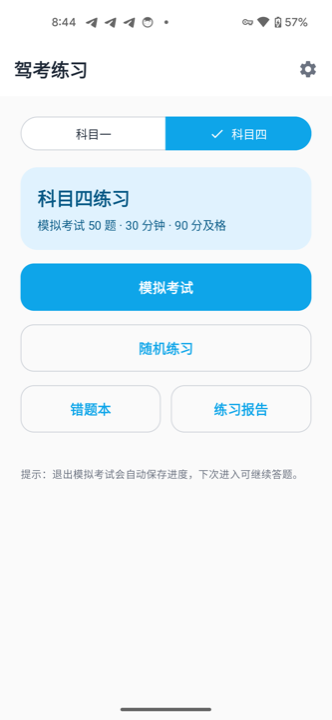
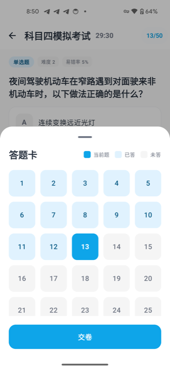
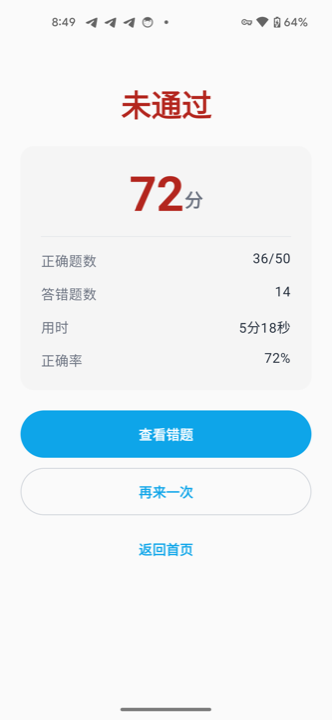
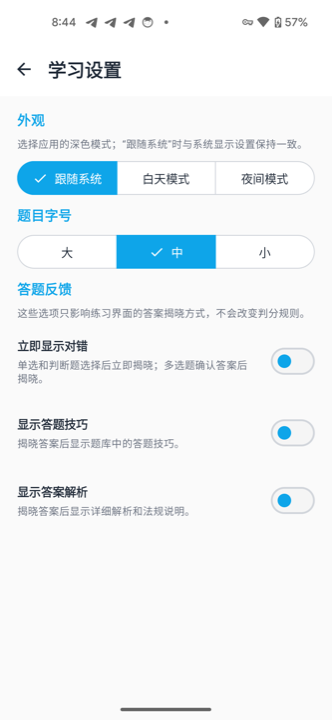
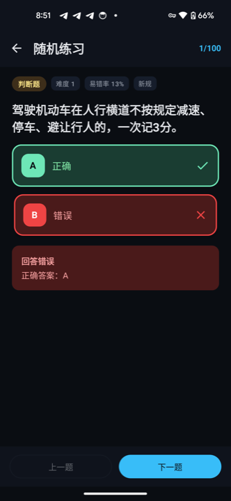
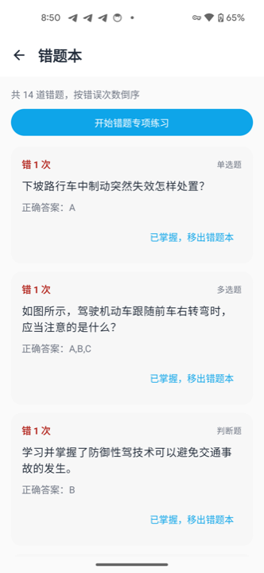
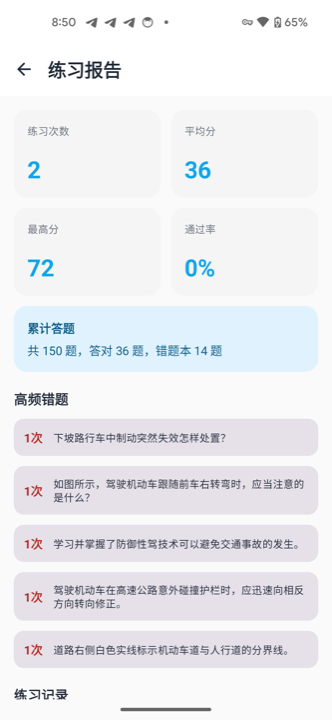

# DrivePrep - 驾考科目一练习

基于 Android Jetpack Compose 的驾考科目一练习应用

## 技术栈

- **架构**: MVVM + Clean Architecture
- **UI**: Jetpack Compose + Material 3
- **依赖注入**: Hilt
- **数据库**: Room
- **异步处理**: Kotlin Coroutines + Flow
- **图片加载**: Coil
- **网络**: Retrofit + Kotlin Serialization

## 项目结构

```
app/
├── data/              # 数据层
│   ├── local/         # Room 数据库
│   ├── repository/    # Repository 实现
│   ├── mapper/        # 数据映射
│   └── preferences/   # 用户设置
├── domain/            # 业务逻辑层
│   ├── model/         # 领域模型
│   └── repository/    # Repository 接口
├── presentation/      # UI 层
│   ├── exam/          # 考试/练习界面
│   ├── home/          # 首页
│   ├── wrongbook/     # 错题本
│   ├── statistics/    # 统计
│   ├── settings/      # 设置
│   ├── navigation/    # 导航
│   └── theme/         # 主题配置
└── di/                # 依赖注入

```

## 功能特性

- ✅ 科目一 / 科目四双题库(共 4300+ 题,离线可用)
- ✅ 模拟考试(科一 100 题·45 分钟 / 科四 50 题·30 分钟),倒计时自动交卷
- ✅ 随机练习,题量与考试标准一致
- ✅ 错题本:按错误次数排序、专项练习、标记掌握
- ✅ 练习报告:练习次数、平均分、通过率、高频错题、历史记录
- ✅ 考试进度自动保存与恢复(按科目+模式独立),支持不保存退出与一键重考
- ✅ 夜间模式三态(跟随系统/白天/夜间),状态栏联动
- ✅ 题目字号三档可调(大/中/小)
- ✅ 答题反馈设置:立即显示对错、答题技巧、答案解析

## 应用预览

| 首页 | 答题卡 | 成绩页 | 设置 |
|---|---|---|---|
|  |  |  |  |

| 随机练习(夜间模式) | 错题本 | 练习报告 |
|---|---|---|
|  |  |  |

## 开始使用

1. 克隆项目(题库 `q.json` 已包含在仓库中)
2. 使用 Android Studio 打开项目
3. 运行应用(或 `./gradlew assembleDebug`)

## 数据模型

题库数据格式参考：https://github.com/doupoa/DrivingTestSubjectOne

## 构建

```bash
./gradlew assembleDebug
```

## License

MIT
